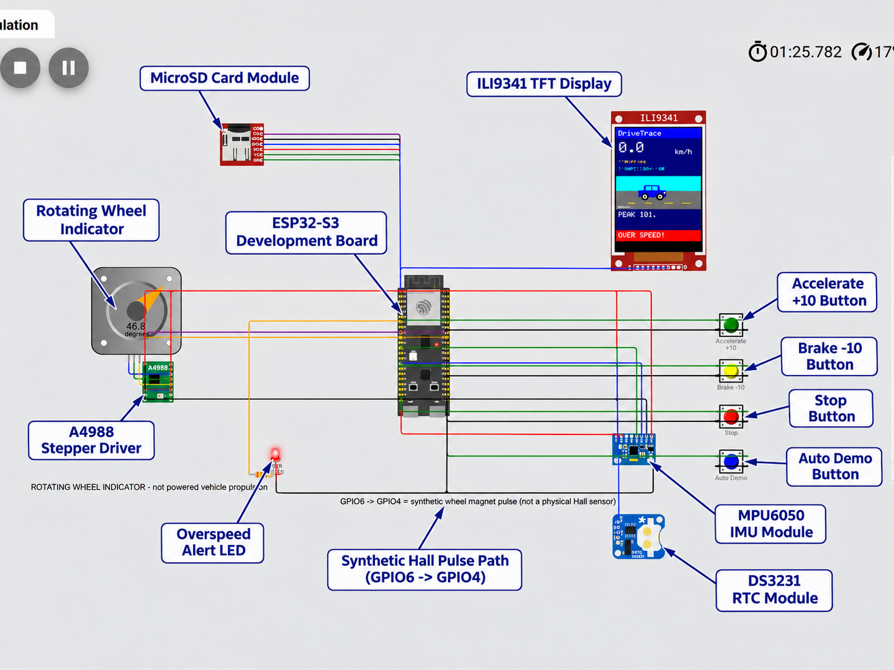

# DriveTrace virtual hardware — Wokwi ESP32-S3

This is the **virtual hardware companion** to the existing DriveTrace PC dashboard. No new DriveTrace application or Git repository is needed.

## DriveTrace Wokwi Circuit Overview

*Figure 1: Annotated screenshot of the DriveTrace virtual hardware demonstration, showing the ESP32-S3, TFT display, wheel indicator, stepper driver, storage, sensors and driving controls. The screenshot shows a demonstration configuration that differs from the checked-in circuit described below; it is not a physical wiring reference.*

## What the Wokwi circuit contains

- ESP32-S3 DevKitC-1 microcontroller.
- ILI9341 320×240 SPI TFT display: measured speed, peak, pre-stop speed, speed limit, overspeed and logging state.
- MPU6050 accelerometer on I²C address **0x69** (AD0 tied high).
- DS1307 simulated real-time clock on I²C **0x68** (stand-in for the planned DS3231).
- SPI microSD card: saves **/RIDE.CSV** with speed samples and **/STOPS.CSV** with stop events, if the simulator initialises the card successfully.
- Red LED to indicate overspeed.
- Four virtual buttons: **Accelerate +10**, **Brake -10**, **Stop**, **Auto Demo**.
- An important *synthetic* Hall-compatible wheel pulse loop: **ESP32 GPIO6 output → GPIO4 interrupt input**.

**This is not an animated car or a real Hall sensor.** The firmware generates wheel rotation pulses based on the chosen virtual speed. The ESP32 measures pulses on its actual GPIO interrupt input and calculates speed using a *simulated* 2.10 m wheel circumference. There is no physical movement. The real wheel sensor will later replace GPIO6 with a 3.3 V-safe Hall sensor.

No physical GPS simulation is included, because the Wokwi part set used here does not provide the NEO-M8N GPS module. The real GPS remains part of the planned hardware.

## Open and run in Wokwi

**[Launch the saved DriveTrace Wokwi simulation](https://wokwi.com/projects/481484838266167297)**

1. Open the saved DriveTrace project using the link above.
2. Click the green **Start Simulation / Play** button.
3. Press **Auto Demo** to run the automatic driving sequence, or use **Accelerate +10**, **Brake -10**, and **Stop** for manual control.
4. Observe the TFT display, overspeed indicator and Serial Monitor.

The saved demonstration is intended to open without manually copying firmware or circuit files. Wokwi may take time to compile and initialize the simulation. The saved online project may differ from the source files checked into this repository.

### Recreate the simulation from GitHub (optional)

If you prefer to run the repository version, open a [new ESP32-S3 project](https://wokwi.com/projects/new/esp32-s3), copy [sketch.ino](sketch.ino) and [diagram.json](diagram.json) into their corresponding editor tabs, and install the libraries listed in [libraries.txt](libraries.txt): Adafruit GFX Library, Adafruit ILI9341 and RTClib. Start the simulation and use the virtual controls. In the repository firmware, the Serial Monitor command `DUMP` prints the ride CSV when storage and serial input are available.

## How the virtual bike works

The ESP32 pulses GPIO6 high-to-low as a **simulated magnet crossing a Hall sensor**. A wire connects GPIO6 to GPIO4, triggering the ESP32's FALLING-edge interrupt. It counts pulses, measures pulse periods and calculates:

\`wheel speed (km/h) = circumference (m) × 3,600,000 / pulse period (microseconds)\`

A virtual model wheel circumference of **2.10 m** is used. It is **not** the final calibrated diameter of any e-bike. A true mechanical model, speed calibration, GPS and physical sensors are not validated here.

The MPU6050 reading is sampled separately. It is *not* used to generate the simulated wheel pulses; it exercises the I²C sensor connection.

## Wiring and pins (virtual project only)

| Function | ESP32-S3 | Simulated part |
|---|---|---|
| Virtual pulse out | GPIO6 | Wire to GPIO4 |
| Wheel Hall pulse input | GPIO4 | Falling-edge interrupt from GPIO6 |
| IMU + RTC I²C | SDA 8, SCL 9 | MPU6050 AD0=HIGH (0x69), DS1307 (0x68) |
| TFT SPI | MOSI 11, MISO 13, SCK 12 | ILI9341 display |
| TFT controls | CS 10, D/C 14 | ILI9341 |
| microSD SPI | MOSI 11, MISO 13, SCK 12 | Shared bus, SD CS 5 |
| Buttons | GPIO18, 17, 16, 21 | To GND with internal pullups |
| Overspeed LED | GPIO7 | Via 330 ohm resistor to red LED |

**Do not copy power-pin assumptions blindly to physical hardware.** Verify the exact display board, supply-voltage and GPIO logic levels when the teacher purchases components. In Wokwi, DS1307 replaces the final DS3231 and wheel pulses are synthetic.

## What this proves — and what it does not

- The **circuit files and firmware are designed** for Wokwi to simulate controller GPIO, display, buttons, virtual pulse input, IMU and storage.
- The existing PC dashboard separately has 24 passing software tests.
- Physical ESP32, wheel sensor, real TFT, GPS, RTC accuracy, power supply, and road testing remain pending.
- Wokwi circuit simulation is educational. A Wokwi 70 km/h demonstration is **not** a physical speed measurement, and the generated microSD CSV is not signed vehicle evidence.
- There is no automatic live bridge from the Wokwi browser to the local PC dashboard. The two demonstrations are separate unless a future simulation-data export bridge is developed.

## Troubleshooting

- **Blank TFT:** confirm the ILI9341 and GFX libraries were installed, and diagram.json wires use TFT CS 10, D/C 14, SCK 12, MOSI 11.
- **No pulses / zero speed:** press Auto Demo or Accelerate; check the GPIO6-to-GPIO4 wire; wait long enough for two pulses (at 10 km/h it can take around 1.5 seconds).
- **SD ERR:** check microSD CS5, SCK12, MOSI11, MISO13, and card power. The main speed/demo still runs even if SD is unavailable.
- **IMU OFF:** check SDA8, SCL9 and MPU6050 AD0 tied to 3.3V.
- **RTC missing:** the simulated DS1307 is used for demonstration timestamps. The final device will use DS3231.
- **Simulation behaves slowly:** TFT full-screen updates are limited to about 1.5 per second. Wokwi simulation time can run slower than wall time.

The working PC app stays at **http://127.0.0.1:8765** when started locally with \`py main.py\`. Do not replace its source with Wokwi-specific code.
